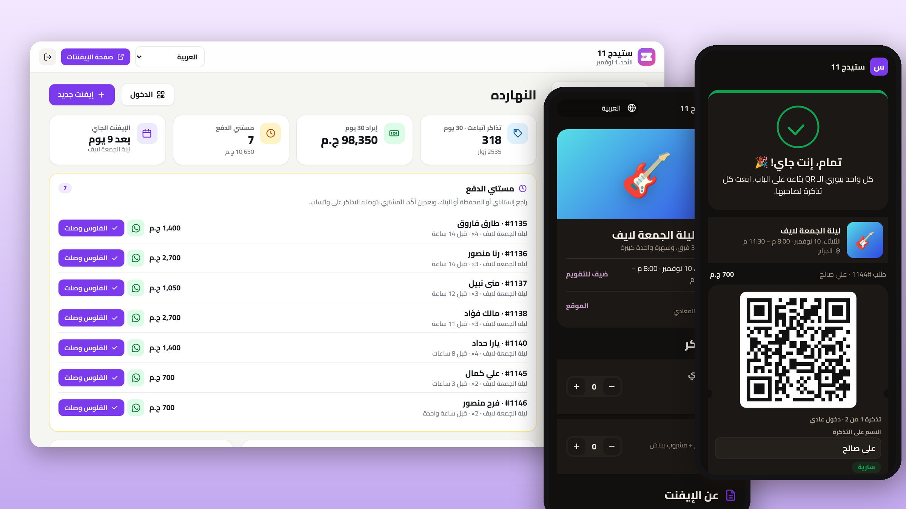
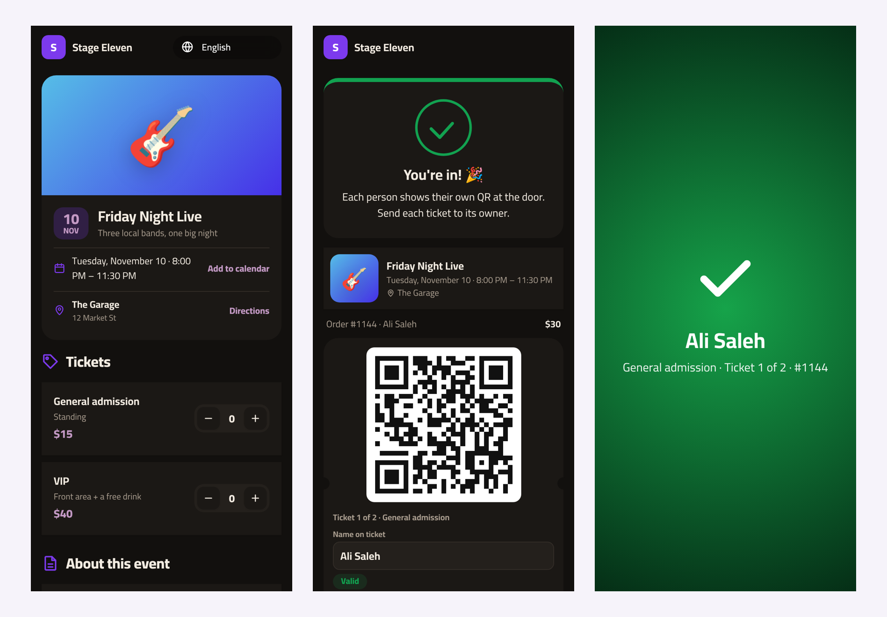

# تذكرة · Tazkara

**نظام تذاكر للحفلات والورش واللقاءات والكورسات والسباقات، على السيرفر بتاعك.**
صفحة لكل إيفنت، وتذاكر ببلاش أو بفلوس، وتذاكر QR على واتساب، وماسح للباب على أي موبايل. من غير عمولة على التذكرة، و8 لغات.

[English](README.md) · [العربية](README.ar.md)

---

## ليه تذكرة؟

أغلب المنظمين الصغيرين (أماكن السهر، والفرق، وأصحاب الورش، والكوميونيتيز، وفرق الجري) بيبيعوا التذاكر على الماسدج والشيتات: "ابعت سكرين شوت التحويل"، وقايمة أسامي على الباب، ومفيش طريقة تفرّق بين تذكرة حقيقية وسكرين شوت متبعتة لحد تاني. منصات التذاكر بتحل ده، بس بتاخد نسبة من كل تذكرة، وغالبًا مش بتدعم إنستاباي وفودافون كاش، وبتحتفظ ببيانات جمهورك.

تذكرة شغال على السيرفر بتاعك وبالدومين بتاعك:

1. **انشره** بضغطة واحدة (والـ HTTPS جاهز).
2. **اعمل إيفنت**: التاريخ والمكان والغلاف وأنواع التذاكر (حجز مبكر، VIP، طلبة…) بأسعارها وأعدادها.
3. **شارك اللينك.** الناس تختار التذاكر وتدفع بالطريقة اللي إنت أصلًا بتستلم بيها: إنستاباي، أو محفظة، أو تحويل، أو أي لينك دفع. والإيفنتات المجانية بتتأكد على طول.
4. **أكّد الدفع بضغطة.** المشتري بيوصله QR لكل تذكرة على واتساب، ويقدر يدي كل تذكرة لصاحبه.
5. **امسح على الباب** من أي موبايل. كل تذكرة بتشتغل مرة واحدة، ولو اتمسحت تاني بيظهر إمتى بالظبط استُخدمت.

## المميزات

**للجمهور**
- 🎟️ **صفحة لكل إيفنت** فيها الغلاف والتاريخ والمكان والاتجاهات، وإضافة للتقويم، والمتاح لحظة بلحظة ("باقي 8 بس")
- 🧾 **حجز سهل**: اختار العدد، واكتب الاسم والموبايل، وخلاص
- 💳 **دفع محلي**: بيانات إنستاباي أو المحفظة أو البنك، ولينك دفع لو عندك. التذاكر اللي ما اتدفعتش بتتحجز وقت معين وبعدين بترجع للبيع.
- 📱 **QR لكل تذكرة** واسم على كل تذكرة، عشان المجموعة تبعت لكل واحد تذكرته
- 🌍 **8 لغات** والعربي بالكامل من اليمين للشمال

**للمنظم**
- 📊 **لوحة النهارده**: التذاكر المباعة، والإيراد ومقارنته، والفلوس اللي مستنية تأكيدك، ومبيعات الإيفنت الجاي ودخوله، ورسم المبيعات
- 🗓️ **الإيفنتات**: أنواع تذاكر براحتك، وأعداد، وحد أقصى للطلب، وتاريخ نهاية للحجز المبكر، وتذاكر مخفية للدعوات، وسعة كلية، وإيفنتات أكتر من يوم، ومسودات، وتكرار الإيفنت
- ✅ **الطلبات**: أكّد الدفع وابعت التذاكر على واتساب بضغطة، أو الغي، أو ضيف **طلبات الشباك والدعوات** بإيدك
- 🚪 **لينك ماسح الباب** لكل إيفنت: ابعته لفريقك من غير حسابات ولا أبلكيشن. فيه عداد "دخلوا / اتباع" لايف، وصوت، وشاشات واضحة للتذاكر اللي ما اتدفعتش أو الملغية أو المستخدمة
- 🔎 **تسجيل الدخول من اللوحة** كمان: بالكاميرا، أو بالبحث بالاسم أو الموبايل أو رقم الطلب، مع إمكانية التراجع
- 📄 **قايمة الحضور** لكل إيفنت Excel، وبوسترات QR، وإشعارات تيليجرام لكل طلب جديد، ونسخة احتياطية كاملة
- 🔌 **توصيلات اختيارية**: دفع أونلاين (Paymob وStripe)، رسايل واتساب أوتوماتيك، إيميل، إشعارات على الموبايل، ونسخ احتياطي يومي (التفاصيل في **التوصيلات** تحت)

## النشر

### الطريقة 1: ضغطة واحدة على Hostinger VPS (الأفضل)

1. دوس **Deploy on Hostinger** فوق.
2. **عشان الـ HTTPS:** وجّه سجل الـ A بتاع الدومين للسيرفر، وحط `DOMAIN=tickets.example.com`. الـ HTTPS مهم كمان عشان كاميرا ماسح الباب تشتغل.
3. **كود الإعداد:** افتح الـ logs بتاعة الـ container اللي اسمه `tazkara` وانسخ `Setup code`، أو حط الكود بتاعك في `SETUP_CODE`.
4. افتح الدومين، وروح على `/admin`، واكتب الكود.

### الطريقة 2: Node.js web app على هوستنجر

hPanel ← **Websites ← Add website ← Node.js app ← Import Git repository**، والملف الرئيسي `server.js`، وحط `DATA_DIR` في فولدر **برّه** فولدر التطبيق.

## الدفع بيشتغل إزاي؟

تذكرة من الأساس مش بيلمس الفلوس، فمفيش عمولة ولا مفاتيح دفع. عايزها أوتوماتيك؟ وصّل Paymob أو Stripe والتذاكر بتتفتح أول ما المشتري يدفع (شوف **التوصيلات** تحت).

1. من **الإعدادات ← الدفع** اكتب الناس تدفع إزاي (مثلًا `InstaPay: you@instapay · فودافون كاش 010…`)، وضيف لينك دفع لو عندك.
2. المشتري بيحجز التذاكر، وصفحة الطلب بتوريه المبلغ وطريقة الدفع وزرار **ابعت إيصال الدفع** (بيفتح واتساب ليك).
3. الطلب بيستنى في **مستني الدفع** وحاجز الأماكن لمدة 48 ساعة (تقدر تغيرها). أول ما الفلوس توصل دوس **الفلوس وصلت**، والـ QR بيتفتح، وتقدر تبعت التذاكر على واتساب بضغطة.
4. الحجوزات اللي ما اتدفعتش بتنتهي لوحدها والأماكن بترجع للبيع.

## ماسح الباب

كل إيفنت ليه **لينك سري لماسح الباب** (الإيفنتات ← ⋯ ← لينك ماسح الباب). ابعته لفريقك، يفتحوه على موبايلاتهم، ويسمحوا للكاميرا، ويمسحوا. كل تذكرة بتشتغل مرة واحدة، والشاشة بتبقى خضرا للتذكرة السليمة، وبرتقاني أو أحمر للمستخدمة أو اللي ما اتدفعتش أو الملغية. ولو اللينك اتسرّب دوس **غيّر اللينك** والقديم هيبطّل.

## التوصيلات (اختيارية)

كل حاجة شغالة من غيرها. شغّل اللي محتاجه بس من **لوحة التحكم ← التوصيلات**. المفاتيح وكلمات السر بتفضل على السيرفر بتاعك: عمرها ما بتتبعت للمتصفح ولا بتدخل في النسخ الاحتياطية.

### الدفع أونلاين: Paymob أو Stripe

لما توصّل شركة دفع، المشتري بيدفع تمن التذاكر من صفحة الطلب، والـ QR بيتفتح لوحده من غير ما تراجع تحويلات.

- **Paymob** (مصر، السعودية، الإمارات، عمان، باكستان): حط الـ Secret key والـ Public key والـ HMAC وأرقام الـ Integration من لوحة Paymob، وبعدين حط لينك الـ callback اللي ظاهر في اللوحة في خانة *Transaction processed callback*.
- **Stripe** (كل الدول): حط الـ Secret key (`sk_live_…` أو `sk_test_…`). ولو عايز، ضيف Webhook على `https://دومينك/webhooks/stripe` للحدث `checkout.session.completed` وحط الـ signing secret بتاعه.
- كل دفعة بتتأكد من الشركة لما العميل يرجع، وتاني من الـ Webhook لو قفل الصفحة. المبلغ والعملة بيتراجعوا، والدفعة بتتحسب مرة واحدة بس. جرّب بمفاتيح تجريبية وزرار **افتح دفعة تجريبية**.
- طريقة الدفع اليدوي ولينك الدفع بتوعك بيفضلوا شغالين لو مفيش شركة دفع.

### رسايل واتساب أوتوماتيك (WhatsApp Cloud API)

من غيرها، لينكات واتساب بضغطة شغالة زي ما هي. ومعاها، الرسايل دي بتتبعت لوحدها من رقم البيزنس بتاعك:

| الرسالة | بتتبعت إمتى | اسم القالب |
|---|---|---|
| تأكيد التذاكر | الطلب يتدفع (أونلاين أو لما تدوس **الفلوس وصلت**) | `tazkara_tickets` |
| تذكير قبلها بيوم | اليوم اللي قبل الحفلة بعد الساعة 10 الصبح | `tazkara_reminder` |

1. اعمل App على [Meta for Developers](https://developers.facebook.com/) وضيفله WhatsApp، وانسخ الـ **Phone number ID** و**Access token دائم** (System user).
2. واتساب مش بيسمح للبيزنس يبدأ محادثة غير بقالب متوافق عليه. اعمل كل قالب بالنص اللي ظاهر في اللوحة بالظبط (فيه زرار نسخ)، استنى الموافقة، وبعدين شغّله.
3. **ابعت تجربة** بيبعت قالب `hello_world` بتاع Meta عشان تتأكد إن التوصيل شغال. Meta بتحاسب على المحادثات اللي البيزنس بيبدأها حسب أسعارها.

### الإيميل (SMTP)

أي إيميل ينفع، زي إيميل هوستنجر (`smtp.hostinger.com`، بورت 465 مع SSL/TLS أو 587). لما توصّل الإيميل، المشتري اللي كاتب إيميله بيوصله التذاكر ومعاها دعوة للتقويم، وطريقة الدفع وهو مستني، وتذكير قبلها بيوم. التنبيهات والنسخة اليومية كل واحدة ليها زرار تشغيل لوحدها.

### إشعارات على الجهاز ده

لوحة التحكم تتثبت على الشاشة الرئيسية للموبايل زي أي تطبيق. دوس **شغّل الإشعارات** على كل جهاز عايزه يوصله إشعار فوري بكل جديد من غير تيليجرام (على الآيفون ضيف اللوحة للشاشة الرئيسية الأول؛ iOS 16.4 أو أحدث). إشعارات تيليجرام لسه شغالة برضه.

### نسخ احتياطي يومي أوتوماتيك

كل يوم التطبيق بيحفظ نسخة في `DATA_DIR/backups/` وبيحتفظ بآخر 14 يوم. تقدر تنزّل أي واحدة من اللوحة، أو تدوس **اعمل نسخة دلوقتي**. شغّل **ابعتلي النسخة الاحتياطية كل يوم** عشان يبقى فيه نسخة مضغوطة برّه السيرفر. وللاسترجاع: **الإعدادات ← نسخة احتياطية ← استرجاع نسخة**. ولو حصل خطأ أو النسخة فشلت، بيوصلك تنبيه (مرة كل ساعة بالكتير).

### باسم وكالتك (White-label)

من لوحة الوكالة (`/hub` ← الإعدادات) حط اسم وكالتك وموقعك: كل صفحات العملاء هتكتب "بواسطة *وكالتك*" بدل تذكرة، أو تخفي السطر خالص. وشاشة دخول العملاء بتظهر اسمك برضه.

### ماسح الباب من غير نت

أماكن الحفلات كتير الشبكة فيها وحشة. ماسح الباب بيحتفظ بنسخة من تذاكر الحفلة على الموبايل (أكواد متشفرة بس، محدش يقدر يطلع منها تذاكر). لو النت قطع، بيكمّل يدخّل الناس على الموبايل، ويظهر **أوفلاين** وعدد الأسكانات المستنية، وأول ما النت يرجع بيزامنها لوحده. لو بابين دخّلوا نفس التذكرة وهما أوفلاين، هيظهرلك تنبيه بعد المزامنة. افتح صفحة الماسح والنت لسه شغال وسيبها مفتوحة.

## وضع الوكالة والفروع وتيليجرام

- **وضع الوكالة** (`HUB_MODE=true`): سيرفر واحد بيشغّل التذاكر لمنظمين كتير، كل واحد على دومينه وبـ HTTPS أوتوماتيك، وإنت بتديرهم من `/hub`. شوف [`examples/agency/`](examples/agency).
- **أكتر من مكان**: نسخة لكل مكان على دومين فرعي. شوف [`examples/branches/`](examples/branches).
- **تيليجرام**: من **الإعدادات ← إشعارات فورية** حط توكن البوت من [‎@BotFather](https://t.me/BotFather) وهيوصلك إشعار مع كل طلب.

## الترخيص

[MIT](LICENSE)

