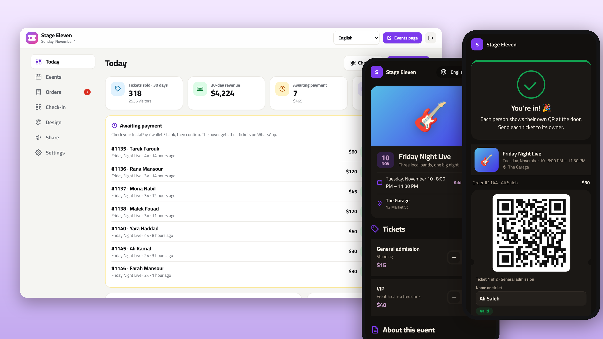
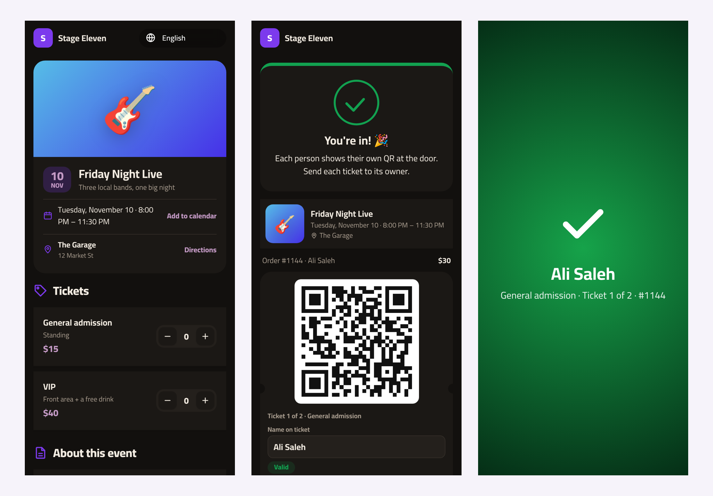
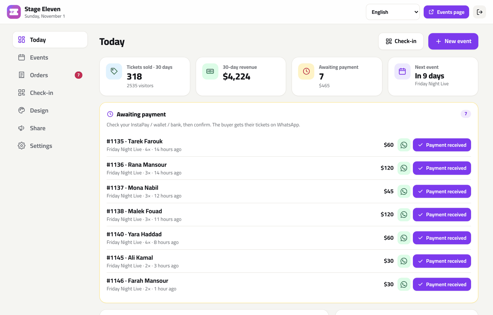
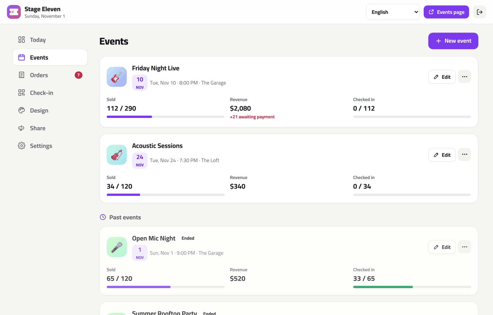
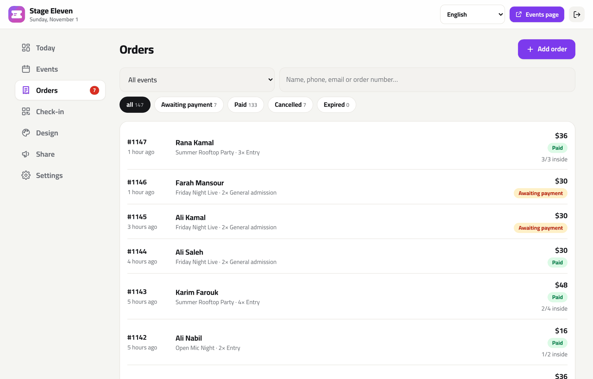
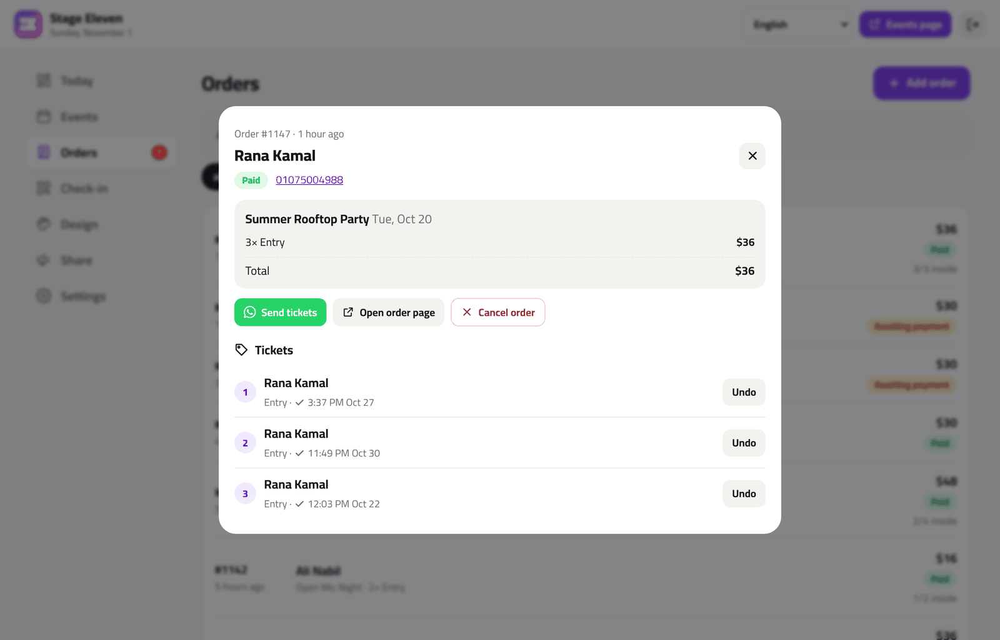
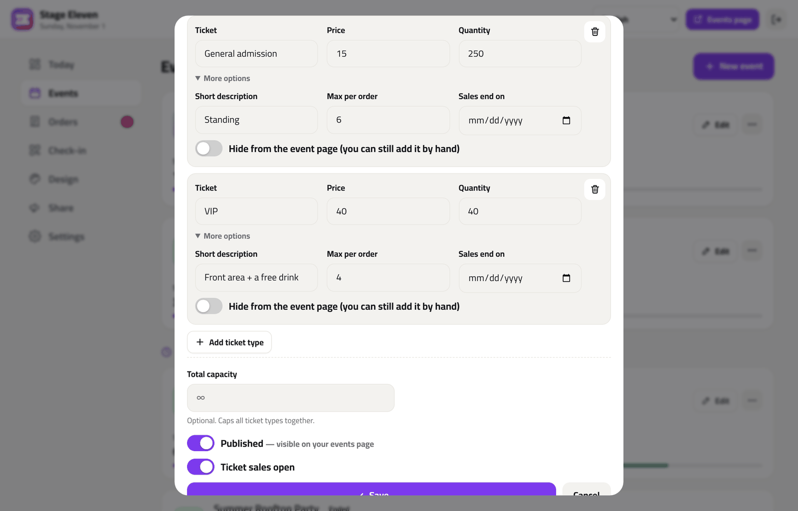
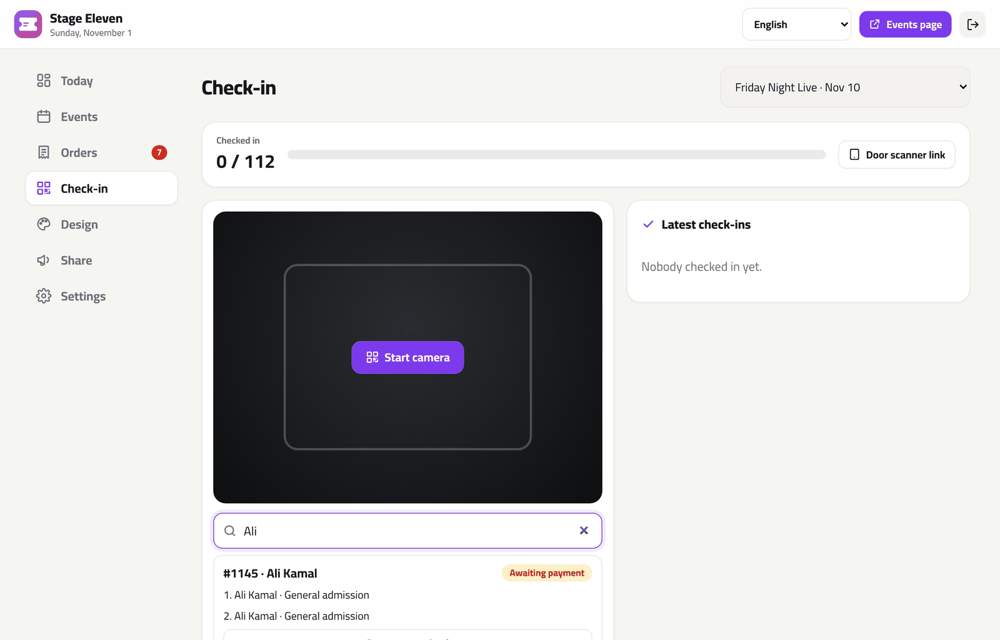
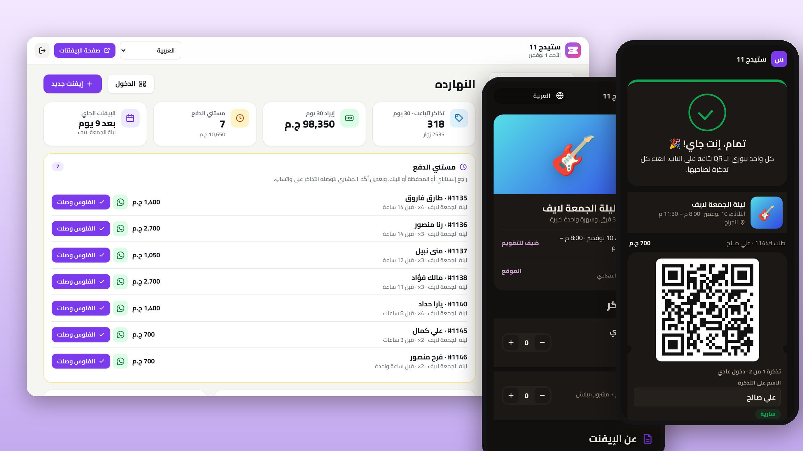

<div align="center">



# Tazkara · تذكرة

**Self-hosted event ticketing for concerts, workshops, meetups, courses and races.**
Event pages, free or paid tickets, QR tickets on WhatsApp and a door scanner on any phone. No fees per ticket. 8 languages.

[](https://www.hostinger.com/docker-hosting?compose_url=https://raw.githubusercontent.com/mashraf1997/tazkara/main/docker-compose.yml&REFERRALCODE=YOUR_REFERRAL_CODE)

[English](README.md) · [العربية](README.ar.md)

</div>

---

## Why Tazkara?

Small organizers (venues, bands, workshop hosts, communities, running clubs) mostly sell tickets through DMs and spreadsheets: "send the InstaPay screenshot", a name list at the door, and no way to tell a real ticket from a forwarded screenshot. Ticketing platforms fix that, but they take a cut of every ticket, often don't support local payment methods, and keep your audience's data.

Tazkara runs on your own server, with your own domain:

1. **Deploy** with one click (HTTPS included).
2. **Create an event**: date, venue, cover, and ticket types (early bird, VIP, student…) with prices and quantities.
3. **Share the link.** People pick tickets and pay the way you already get paid: InstaPay, mobile wallets, bank transfer or any payment link. Free events confirm instantly.
4. **Confirm payments with one tap.** The buyer gets one QR per ticket on WhatsApp and can pass each ticket to a friend.
5. **Scan at the door** from any phone. Each ticket works once, and a second scan shows exactly when it was used.



## Features

**For your audience**
- 🎟️ **Event pages** with cover, date, venue and directions, add-to-calendar, live availability ("only 8 left") and a share button
- 🧾 **Simple checkout**: pick quantities, enter name and phone, done. Email is optional.
- 💳 **Local payments**: your InstaPay / wallet / bank details and an optional payment link (Stripe, PayPal, Paymob…). Unpaid tickets are held for a set time, then released.
- 📱 **A QR for every ticket**, one link per order, with a **name on each ticket** so a group can split up and forward tickets
- 🌍 **8 languages** (English, العربية with full RTL, Español, Português, Français, Türkçe, Bahasa Indonesia, हिन्दी), Google-friendly event data (schema.org)

**For organizers**
- 📊 **Today dashboard**: tickets sold, revenue with trend, payments waiting for you, the next event's sales and check-ins, a 14-day sales chart
- 🗓️ **Events**: as many ticket types as you need, quantities, max per order, early-bird cut-off dates, hidden types (invitations), total capacity, multi-day events, drafts, duplicate an event
- ✅ **Orders**: confirm a payment and send the tickets on WhatsApp in one tap; cancel, restore, or add **box-office / invitation orders** by hand
- 🚪 **Door scanner link** for each event: send it to your volunteers; no accounts or app needed. A live "checked in / sold" counter, sounds, and clear red / orange screens for unpaid, cancelled, wrong-event or already-used tickets.
- 🔎 **Check-in from the admin** too: by camera, or search by name, phone or order number, with undo
- 📄 **Attendee list** for each event as an Excel file, posters with QR codes, Telegram alerts for new orders, full backup and restore
- 🎨 4 themes, 5 Arabic-friendly fonts, any colour, logo and cover, with a live preview

**For the server**
- 🔌 **Optional connections**: online payments (Paymob, Stripe), automatic WhatsApp messages, email, phone notifications, daily backups ([details](#connections-optional))
- Node.js + Express, **4 small dependencies**, no database to set up (atomic JSON files)
- Runs on the smallest VPS. Docker image for `amd64` and `arm64`, tested on Node 18–24.
- **Automatic HTTPS** with Caddy, **setup code** to protect a fresh install, **demo mode**
- **Agency mode**: one server runs ticketing for many organizers, each on their own domain

## Screenshots

| Today | Events |
|---|---|
|  |  |
| **Orders** | **Order** |
|  |  |
| **Event editor** | **Check-in** |
|  |  |

<details><summary>Arabic (RTL)</summary>



</details>

## Deploy

### Option 1 — One click on a Hostinger VPS (recommended)

1. Click **Deploy on Hostinger** above. Docker Manager reads [`docker-compose.yml`](docker-compose.yml), which runs Tazkara behind [Caddy](https://caddyserver.com).
2. **HTTPS:** point your domain's DNS **A record** at the VPS and set `DOMAIN=tickets.example.com`. Caddy gets the certificate automatically. HTTPS is also what lets the door scanner use the camera.
3. **Setup code:** open the `tazkara` container's **logs** in Docker Manager and copy `Setup code: XXXX-XXXX`, or set your own with `SETUP_CODE`.
4. Open your domain, go to `/admin`, enter the code and finish the 1-minute setup.

### Option 2 — Hostinger Node.js web app

1. hPanel → **Websites → Add website → Node.js app → Import Git repository**, pick your fork.
2. Framework **Express**, Node **20+**, entry file `server.js`.
3. Environment variables: `SETUP_CODE` and `DATA_DIR` (a folder **outside** the app folder, e.g. `/home/<user>/tazkara-data`).
4. Deploy and open `/admin`.

### Option 3 — Docker anywhere

```bash
curl -O https://raw.githubusercontent.com/mashraf1997/tazkara/main/docker-compose.yml
```

```bash
DOMAIN=tickets.example.com docker compose up -d
```

```bash
docker compose logs tazkara | grep "Setup code"
```

### Option 4 — Plain Node.js

```bash
git clone https://github.com/mashraf1997/tazkara.git
cd tazkara
npm install --omit=dev
npm start
```

## How payments work

By default Tazkara never touches the money, so there are no fees and no payment keys to manage. Prefer automatic? Connect Paymob or Stripe and tickets unlock as soon as the buyer pays ([Connections](#connections-optional)).

1. In **Settings → Payments**, write how people pay (e.g. `InstaPay: you@instapay · Vodafone Cash 010…`) and optionally add a payment link.
2. A buyer reserves paid tickets. Their order page shows the amount, your details, a **Pay now** button and **Send payment receipt** (opens WhatsApp to you).
3. The order waits in **Awaiting payment**, holding its seats for `holdHours` (48 by default). When the money arrives, press **Payment received**. The QR codes unlock and you can send the tickets on WhatsApp in one tap.
4. Unpaid reservations expire on their own and the seats go back on sale.

## The door scanner

Every event has a secret **door scanner link** (Events → ⋯ → Door scanner link). Send it to your team; they open it on their phones, allow the camera, and scan. Each ticket can be used once, and the screen shows green for valid tickets and orange or red for used, unpaid, cancelled or wrong-event tickets. If a link leaks, press **Change link** and the old one stops working.

## Connections (optional)

Everything works without these. Turn on only what you need in **Admin → Connections**. Keys and passwords stay on your server: they are never sent to the browser and never included in exports or backups.

### Online payments: Paymob or Stripe

With a payment provider connected, buyers pay for their tickets on the order page and the QR codes unlock on their own, no need to check transfers.

- **Paymob** (Egypt, Saudi Arabia, UAE, Oman, Pakistan): paste your secret key, public key, HMAC secret and integration IDs from the Paymob dashboard, then paste the callback URL shown in the panel as the *Transaction processed callback*.
- **Stripe** (worldwide): paste your secret key (`sk_live_…` or `sk_test_…`). Optionally add a webhook to `https://your-domain/webhooks/stripe` for `checkout.session.completed` and paste its signing secret.
- Each payment is checked with the provider when the customer comes back, and again by the webhook if they close the page. The amount and currency are verified and a payment is counted only once. Use test keys and **Open a test payment** to try it.
- Your manual payment details and payment link still work when no provider is connected.

### Automatic WhatsApp messages (WhatsApp Cloud API)

Without this, the one-tap WhatsApp links keep working as before. With it, these messages go out on their own from your business number:

| Message | Sent when | Template name |
|---|---|---|
| Tickets confirmed | the order is paid (online, or you press **Payment received**) | `tazkara_tickets` |
| Day-before reminder | the day before the event, after 10:00 | `tazkara_reminder` |

1. Create an app at [Meta for Developers](https://developers.facebook.com/) with the WhatsApp product, and copy the **phone number ID** and a **permanent access token** (system user).
2. WhatsApp only lets businesses start conversations with approved templates. Create each template with the exact text shown in the panel (copy button), wait for approval, then switch it on.
3. **Send test** sends Meta's `hello_world` template to check the connection. Meta bills business-initiated conversations according to its own pricing.

### Email (SMTP)

Use any mailbox, for example your Hostinger email (`smtp.hostinger.com`, port 465 with SSL/TLS, or 587). With email set up, buyers who leave an email get their tickets with a calendar invite, the payment instructions while the order waits, and a reminder the day before. Alerts and the daily backup copy can each be switched on or off.

### Notifications on this device

The admin can be installed on your phone's home screen like an app. Press **Turn on notifications** on each device that should get an instant notification for new activity, no Telegram needed (on iPhone, add the admin to the home screen first; iOS 16.4+). Telegram alerts still work too.

### Automatic daily backups

Every day the app saves a backup to `DATA_DIR/backups/` and keeps the last 14 days. Download any of them from the panel, or press **Back up now**. Turn on **Email me the daily backup** to keep a gzipped copy off the server. To restore, use **Settings → Backup → Restore backup**. If the app hits an error or a backup fails, you get an alert (at most once an hour).

### White-label (agency mode)

In the agency panel (`/hub` → Settings), set your agency name and website: every client page then says "powered by *your agency*" instead of Tazkara, or you can hide the line completely. Client login screens show your name too.

### Door scanner without internet

Venues often have bad signal. The door scanner keeps a copy of the event's ticket list on the phone (only hashed codes, so the list can't be turned into tickets). If the connection drops, it keeps checking people in on the phone, shows an **Offline** badge with the number of scans waiting, and syncs them as soon as the internet is back. If two doors let the same ticket in while offline, you get a warning after the sync. Open the scanner page while you still have internet and keep it open.

## Agency mode, branches and Telegram

- **Agency mode** (`HUB_MODE=true`): one server hosts ticketing for many organizers, each on `name.yourdomain.com` or their own domain with automatic HTTPS, managed from `/hub` with billing and suspend/resume. See [`examples/agency/`](examples/agency).
- **Several venues**: run one instance per venue on its own subdomain. See [`examples/branches/`](examples/branches).
- **Telegram**: in **Settings → Instant notifications**, paste a bot token from [@BotFather](https://t.me/BotFather) to get a message for every new order. The token stays on your server and out of backups.

## Configuration

| Variable | Default | Description |
|---|---|---|
| `PORT` | `3000` | HTTP port |
| `DATA_DIR` | `./data` (`/data` in Docker) | Settings, events, orders, tickets, images |
| `SETUP_CODE` | random, printed in the logs | Required to create the admin account on a fresh install |
| `DOMAIN` | *(empty)* | **docker-compose only.** Your domain for automatic HTTPS |
| `TRUST_PROXY` | `loopback, linklocal, uniquelocal` | Express `trust proxy` setting |
| `DEMO_MODE` | `false` | Public demo that resets itself |
| `DEMO_PASSWORD` | `demo1234` | Admin password shown in the demo |
| `DEMO_RESET_MINUTES` | `60` | Demo reset interval |
| `DEMO_LANG` / `DEMO_TYPE` | `en` / `concert` | Demo language and type (`concert`, `workshop`, `conference`, `sports`) |
| `HUB_MODE` | `false` | `true` turns the server into an agency hub |
| `BASE_DOMAIN` | `localhost` | Agency mode: clients get `<name>.BASE_DOMAIN` |
| `HUB_DOMAIN` | *(empty)* | Agency mode: only show the panel on this host |

### Live demo

```bash
docker run -d -p 80:3000 -e DEMO_MODE=true ghcr.io/mashraf1997/tazkara:latest
```

A venue with an event tonight (partly checked in), upcoming events with sales and unpaid orders, and a past event. Everything resets every hour.

### Data & backups

```
data/
├── db.json        # settings and events (with ticket types)
├── orders.json    # orders
├── tickets.json   # one row per ticket: holder, check-in time
└── uploads/       # cover images
```

Copy the folder, or use **Settings → Backup** to download and restore everything as one file. Ticket links keep working after a restore.

## Security

- A fresh install can only be claimed with the **setup code**.
- scrypt password hashing, signed `HttpOnly` / `SameSite=Strict` session cookies, CSRF header check, rate-limited login, setup, order and scanner endpoints.
- Ticket, order and scanner links use random 96-bit tokens and are marked `noindex`. QR codes only appear once an order is paid.
- Prices and availability are always checked on the server, so tickets can never be oversold, even by hand.

## Development

```bash
npm install
npm run dev
```

```bash
npm test
```

The ticket rules (availability, holds, limits, validity at the door) live in [`src/tickets.js`](src/tickets.js) with their own tests. Translations are in [`locales/`](locales).

## License

[MIT](LICENSE)
